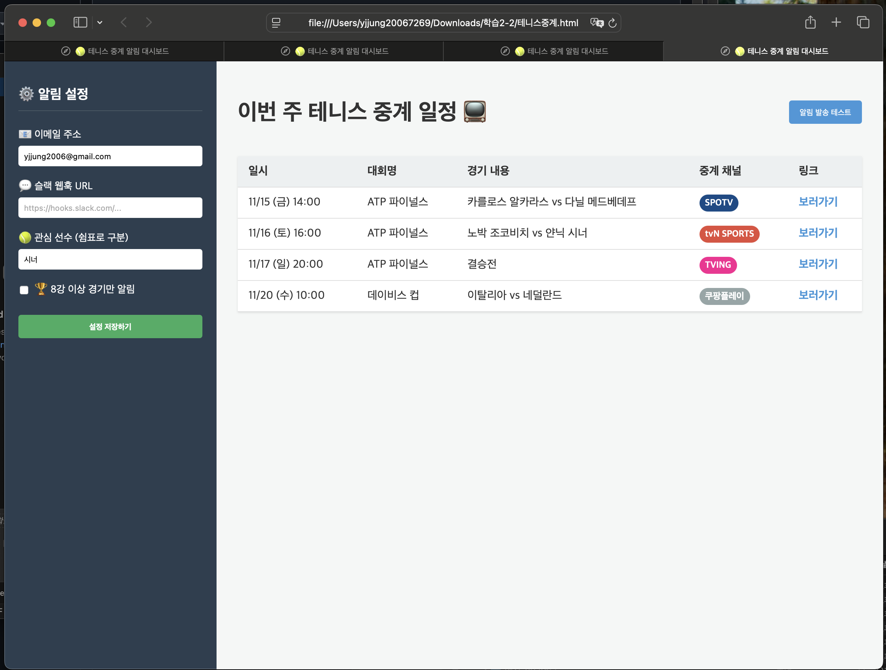

# 제작·검증 기록: (페이지 이름)

## 두 AI 비교
- AI A (서비스·모델 이름): Gemini 3.1 Pro (x1.5)
- AI B (서비스·모델 이름): Claude Opus 4.8 (x1.5)
- 동일한 기획서와 함께 전달한 요청: 제미나이에서 만든 기획서5.md 를 제미나이와 클로드에 주고 실행

| 테스트 내용 | 제미나이 | 클로드 |
 1. | UI 렌더링 | 제미나이 | 클로드 |
 2. | 데이터표시 | 제미나이 | 클로드 |
 3. | 설정저장하기 | 제미나이 | 클로드 |
 4. | 안내 메시지 | 제미나이 | 클로드 |
 5. | 모바일 호환성 | 제미나이 | 클로드 |
 6. | 알림수단 | 제미나이 | 클로드 |
 7. | 알림 발송 테스트 | 제미나이 | 킄로드 |

- 선택한 결과물과 근거:

## 테스트 기록
| 번호 | 테스트 내용 | 예상 결과 | 실제 결과 |
| 1. | UI 렌더링 | 설정영역과 데이터 영역 구분 구성 | 잘 동작 |
| 2. | 데이터표시 | 가상의 데이터를 만들어 화면의 데이터 영역에 표시 | 잘 동작 |
| 3. | 설정저장하기 | 입력한 내용이 브라우저 종료후 다시 열어도 설정한 대로 남아 있음  | 잘 동작 |
| 4. | 안내 메시지 | 버튼은 있으나 동작하지 않는데 대한 안내 | 안내 메시지 잘 나옴|
| 5. | 모바일 호환성 | 화면을 줄여도 안보이는 영역이 안 생김 | 잘 동작 |
| 6. | 알심 수단 | 이메일과 슬랙을 이용하는 조건이 다르므로 모두 가능해야 함 | 클로드는 둘 중 하나를 선택하는 형태로 구현됨 |

## 수정 기록

### 수정 기록 1
- 발견한 문제: 알림 수단을 이메일과 슬랙으로 알리는 조건을 구체화 필요
- AI에게 전달한 요청:
- 수정 후 테스트 결과:
- 수정 이유:

### 수정 기록 2
- 발견한 문제:"보러가기 "기능의 정확한 내용 미제시
- AI에게 전달한 요청:
- 수정 후 테스트 결과:
- 수정 이유:

### 수정 기록 3
- 발견한 문제:
- AI에게 전달한 요청:
- 수정 후 테스트 결과:
- 수정 이유:

## 사용자 테스트
- 테스트 참여자와 요청한 작업:
- 사용자의 행동과 질문:
- 받은 피드백:
- 반영 내용과 결과:

