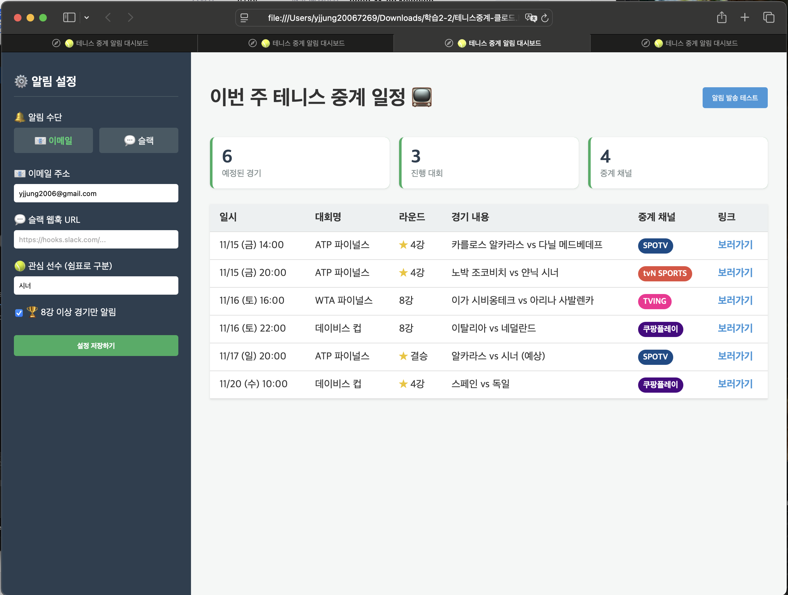

# 제작·검증 기록: (페이지 이름)

## 두 AI 비교
- AI A (서비스·모델 이름): Gemini 3.1 Pro (x1.5)
- AI B (서비스·모델 이름): Claude Opus 4.8 (x1.5)
- 동일한 기획서와 함께 전달한 요청: 제미나이에서 만든 기획서5.md 를 제미나이와 클로드에 주고 실행

| 번호 | 테스트 내용 | AI A | AI B |
| --- |--- | --- | --- |
| 1 | UI 렌더링 | 제미나이 | 클로드 |
| 2 | 데이터표시 | 제미나이 | 클로드 |
| 3 | 설정저장하기 | 제미나이 | 클로드 |
| 4 | 안내 메시지 | 제미나이 | 클로드 |
| 5 | 모바일 호환성 | 제미나이 | 클로드 |
| 6 | 알림수단 | 제미나이 | 클로드 |
| 7 | 알림 발송 테스트 | 제미나이 | 클로드 |
| 8 | 보러가기 | 제미나이 | 클로드 |

- 선택한 결과물과 근거: 제미나이 3.1, 알림기능 구현이 기획의도에 부합

## 테스트 기록
| 번호 | 테스트 내용 | 예상 결과 | 실제 결과 | 비고 |
| --- | --- | --- | --- | --- |
| 1 | UI 렌더링 | 설정영역과 데이터 영역 구분 구성 | 동작 | |
| 2 | 데이터표시 | 가상의 데이터를 만들어 화면의 데이터 영역에 표시 | 동작 | |
| 3 | 설정저장하기 | 입력한 내용이 브라우저 종료후 다시 열어도 설정한 대로 남아 있음  | 동작 | |
| 4 | 안내 메시지 | 버튼은 있으나 동작하지 않는데 대한 안내 | 동작 | |
| 4-1 | 안내 메시지 | 알림 발송 방법에 대한 안내 메시지 출력 | 설명 없음 | |
| 5 | 모바일 호환성 | 화면을 줄여도 안보이는 영역이 안 생김 | 동작 | |
| 6 | 알림 수단 | 이메일과 슬랙을 선택/설정 각가 가능해야 함 | 동작 | |
| 7 | 알림 발송 테스트 | 미구현 상태이므로 안내 메시지 출력 | 안내 메시지 나옴 |  |
| 8 | 보러가기 | 미구현 상태이므로 안내 메시지 출력 | 동작 | 클로드 : 안내 메시지 안나오고 새로운 탭에 같은 페이지 내용 출력 |

## 수정 기록

### 수정 기록 1
- 발견한 문제: 알림 수단을 이메일 또는 슬랙 중에 선택하도록 되어 있음
- AI에게 전달한 요청: 설정 조건이 있으면 이메일로 알리고, 슬랙으로는 중계 1시간 전 경기만 알려줘
- 수정 후 테스트 결과:
- 수정 이유: 모든 내용을 알림 받을 필요는 없고, 설정으로 제한된 내용만 받는 것이 효과적일 것으로 팓단

### 수정 기록 2
- 발견한 문제:"보러가기 " 클릭하면 새 탭에서 같은 페이지가 열림
- AI에게 전달한 요청: 현재 미구현 상태이므로 클릭하면 안내 메시지를 보여줘
- 수정 후 테스트 결과:
- 수정 이유: 실행안되는 사유를 메시지로 표시해 줄 필요가 있음

### 수정 기록 3
- 발견한 문제:대회 내용 화면에 경기가 몇 라운드인지 내용이 없음
- AI에게 전달한 요청: 대회명 다음에 라운드 내용 추가
- 수정 후 테스트 결과:
- 수정 이유: 실행안되는 사유를 메시지로 표시해 줄 필요가 있음

### 수정 기록 4
- 발견한 문제: 알림에 대한 설명 메시지가 없어 동작 방법/내용을 모름
- AI에게 전달한 요청: 설정 방법 및 내용에 대한 안내 메시지 출력
- 수정 후 테스트 결과:
- 수정 이유: 알림은 축약된 내용을 원하는 시간에 받기 위한 것으로 설정에 따라 변하는 알림 내용을 안내할 필요가 있음

## 사용자 테스트
- 테스트 참여자와 요청한 작업:
- 사용자의 행동과 질문:
- 받은 피드백:
- 반영 내용과 결과:

## 클로드로 구현한 화면

